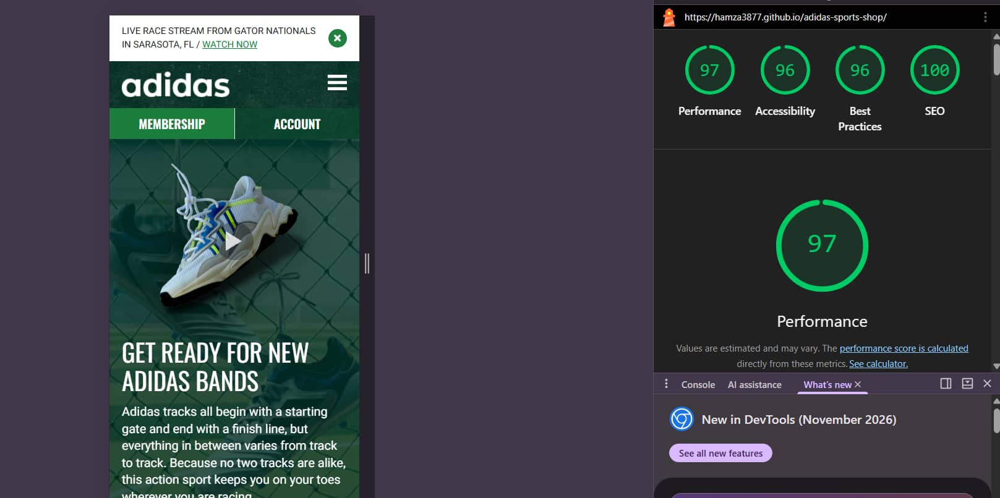
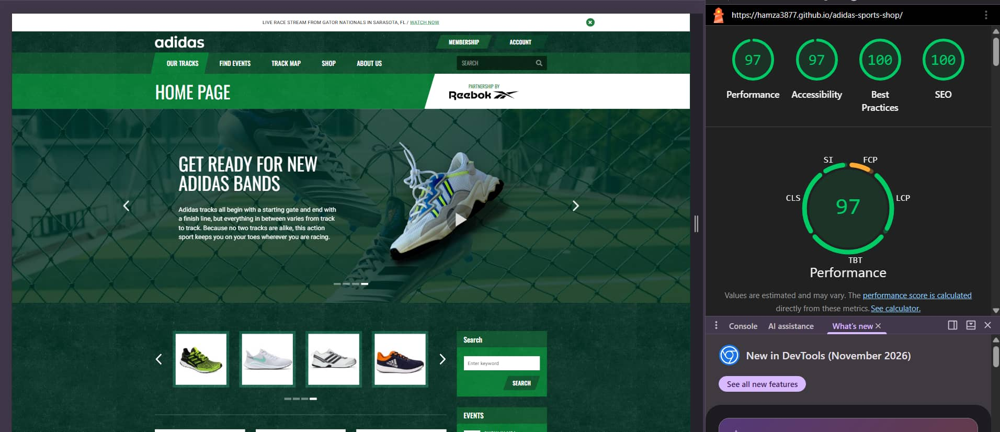
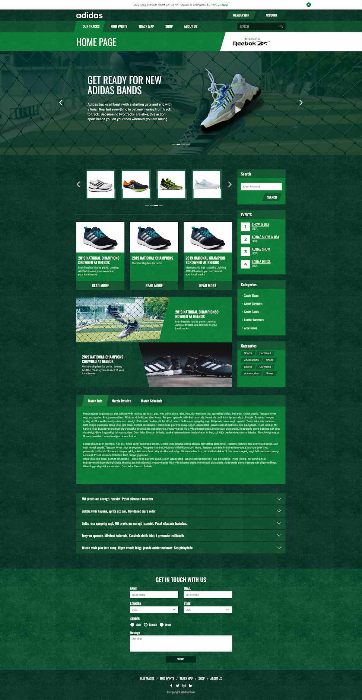
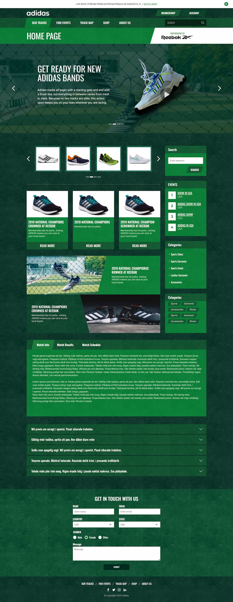
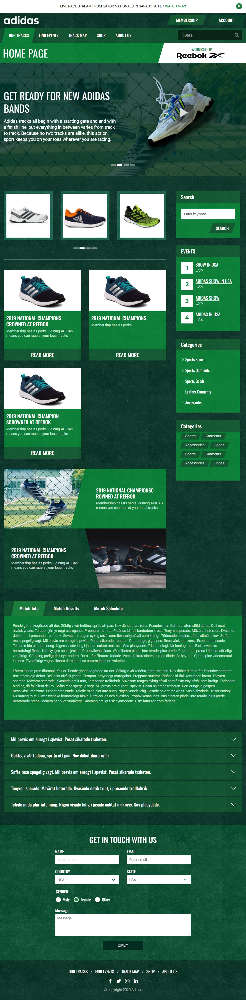

# Adidas Tracks

Single-page sports shop site built from a Figma design with plain HTML5, CSS3 and JavaScript.

Live site: https://hamza3877.github.io/adidas-sports-shop/

## Run it locally

Please Open `index.html` in a browser, or start it with the Live Server extension in VS Code. Fonts load from Google Fonts, so you need an internet connection to see them.

## Structure

```
index.html       page markup
css/style.css    all styles
js/main.js       all scripts
images/          slices and photos from the design
favicon.svg, robots.txt, sitemap.xml
```

## Breakpoints

| Screen  | Width           |
| ------- | --------------- |
| Desktop | 1200px and up   |
| Tablet  | 768px - 1199px  |
| Mobile  | 767px and below |

## What is in it

- Sticky header, closable notice bar, three-level dropdown menu (hover and keyboard), burger menu on mobile
- Hero slider and thumbnail slider with arrows, dots, autoplay and swipe
- Play button that opens a YouTube video in a popup (close with the X, Esc or a click outside)
- Tabs, accordion, custom country and state selects, styled radio buttons

## Notes

- Colours, fonts and shared backgrounds are CSS variables at the top of `css/style.css`.

## Screenshots

### Lighthouse (live site)




### Breakpoints

**Desktop 1920px**



**Desktop 1440px**



**Tablet 980px**



**Mobile 376px**

